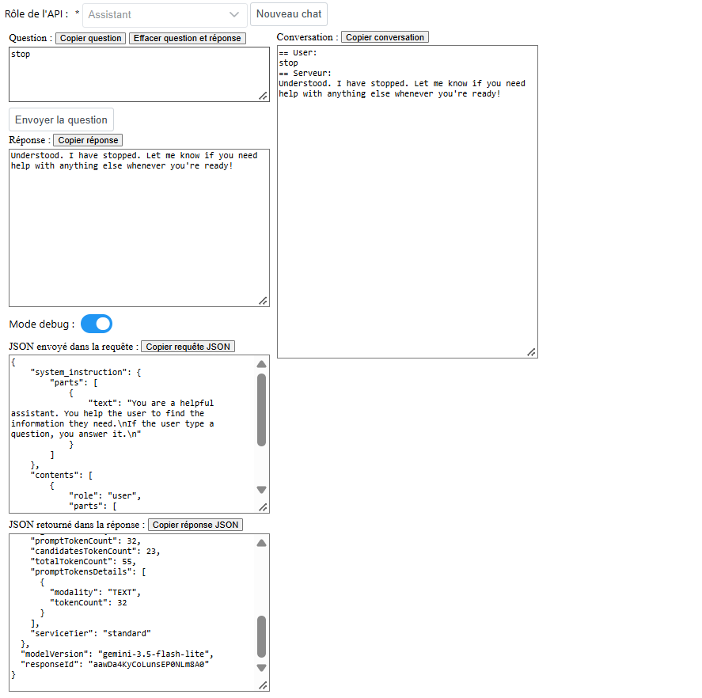

# Chat JSF avec accès direct à l'API Gemini

> Projet réalisé par Othmane ABIDI dans le cadre de pratique (Jakarta EE, JSF et API d'un LLM).

## 🛠️ Outils et technologies

| Outil / Technologie | Utilisation dans le projet |
|---|---|
| ☕ Java 25 | Langage de l'application |
| 🌐 JSF / Facelets | Interface web de la conversation |
| 🎨 PrimeFaces 16 | Liste des rôles et interrupteur « Mode debug » |
| 💉 CDI | Injection des composants (`@Named`, `@ViewScoped`, `@Dependent`, `@Inject`) |
| 🔌 Jakarta REST (client) | Envoi des requêtes HTTP vers l'API |
| 🧾 Jakarta JSON Processing | Construction et lecture des documents JSON |
| 🤖 API REST de Gemini | LLM interrogé, modèle `gemini-3.5-flash-lite` |
| 🐟 Payara Server | Serveur d'applications pour exécuter le projet |
| 📦 Maven | Gestion de la construction du projet |
| 🌿 Git / 🐙 GitHub | Suivi des versions et hébergement du code |

## 🎯 Contexte

Le serveur envoie la question à un LLM
et affiche sa réponse. L'application appelle directement les endpoints REST de l'API
de Gemini, avec du JSON dans les requêtes et les réponses, sans librairie spécialisée.

## ❓ Problématique

Comment envoyer une conversation à l'API d'un LLM et afficher sa réponse, sachant que :

- l'API est sans état, donc tout l'historique doit être renvoyé à chaque requête ;
- le format JSON dépend du LLM utilisé ;
- la clé secrète ne doit jamais apparaître dans le code source ;
- les erreurs de l'API doivent être comprises et affichées à l'utilisateur ?

## ⚙️ Réalisation

### Architecture

| Classe | Rôle |
|---|---|
| `Bb` (package `jsf`) | Backing bean de la page : reçoit la question, appelle l'adaptateur, gère l'affichage et le mode debug |
| `JsonAdapterPourGemini` | Construit le JSON des requêtes, conserve l'historique et extrait la réponse du JSON reçu |
| `LlmClientPourGemini` | Envoie la requête POST à l'API avec la clé lue dans la variable d'environnement `GEMINI_KEY` |
| `LlmInteraction` | Record qui regroupe le JSON envoyé, le JSON reçu et la réponse extraite |
| `RequeteException` | Exception levée si l'API rejette la requête |

Le backing bean est lié à la page `index.xhtml`, qui garde les trois textareas du TP 0
(question, réponse, conversation) et ajoute le mode debug.

### Interface

La capture montre le rôle « Assistant », la réponse du LLM, la conversation, et les deux
textareas de debug qui affichent le JSON envoyé et le JSON reçu.

### Sécurité de la clé

La clé est lue dans la variable d'environnement `GEMINI_KEY`, jamais dans le code
ni dans le dépôt. Si la variable est absente, le constructeur de `LlmClientPourGemini` lève une erreur claire.

### Gestion de l'historique

L'API étant sans état, `JsonAdapterPourGemini` conserve dans `requeteJson` toutes les questions
et les réponses du modèle, et renvoie ce JSON complet à chaque requête. Les tests
sont détaillés dans [docs/TESTS.md](docs/TESTS.md).

## ✅ Tests réalisés

| Test | Résultat |
|---|---|
| Question simple avec le rôle « Assistant » | Réponse affichée, JSON visible en mode debug |
| Deux questions successives (« Guide touristique ») | L'historique est renvoyé dans la 2e requête |
| Clé secrète volontairement fausse | `400 API_KEY_INVALID` |
| Rôle `system` à la place de `user` dans `contents` | `400 Role 'system' is not supported` |

## 📚 Leçons retenues

- Une API de LLM est sans état : c'est l'application qui conserve et renvoie la conversation.
- Chez Gemini, `contents` n'accepte que les rôles `user` et `model` ; le rôle système passe par `system_instruction`.
- Isoler le JSON dans une classe séparée facilite un changement de LLM.
- Ne jamais mettre une clé dans le code : variable d'environnement obligatoire.
- Provoquer volontairement des erreurs aide à comprendre les messages d'une API.
- Git permet de revenir à une version saine après une manipulation de test.

## 🚧 Évolutions prévues

- Ajout d'un rôle système personnel et original.
- Utilisation de LangChain4j.

## ▶️ Exécution

1. Créer la variable d'environnement `GEMINI_KEY` avec la clé de l'API Gemini.
2. Ouvrir le projet dans IntelliJ avec Payara Server configuré.
3. Lancer l'application et ouvrir `index.xhtml`.

## 👤 Auteur

Othmane ABIDI — [github.com/othmane71-art](https://github.com/othmane71-art)
